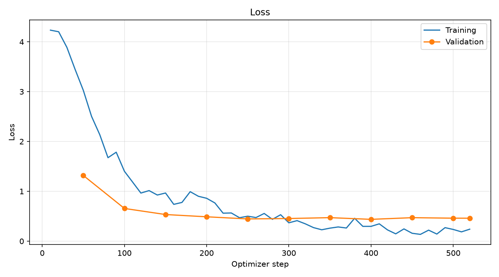
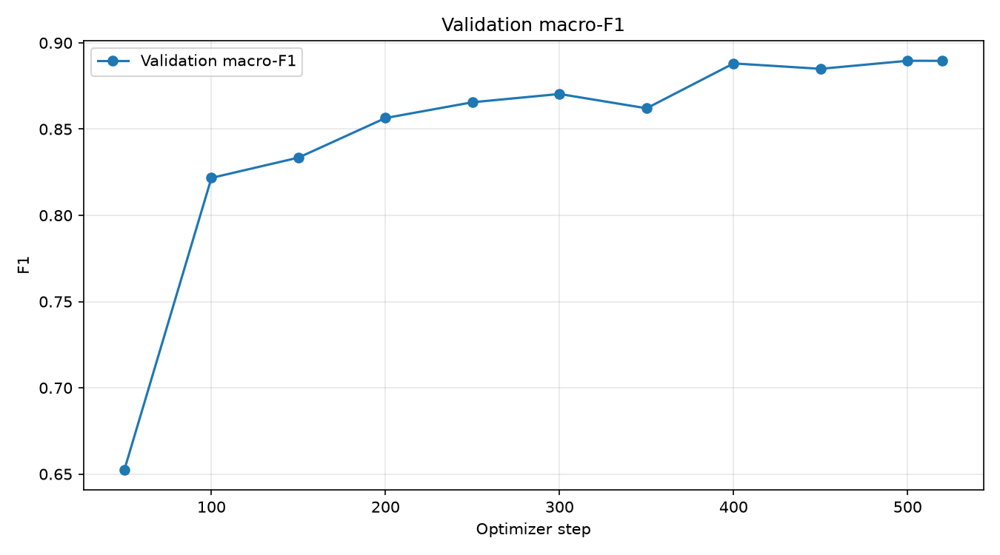
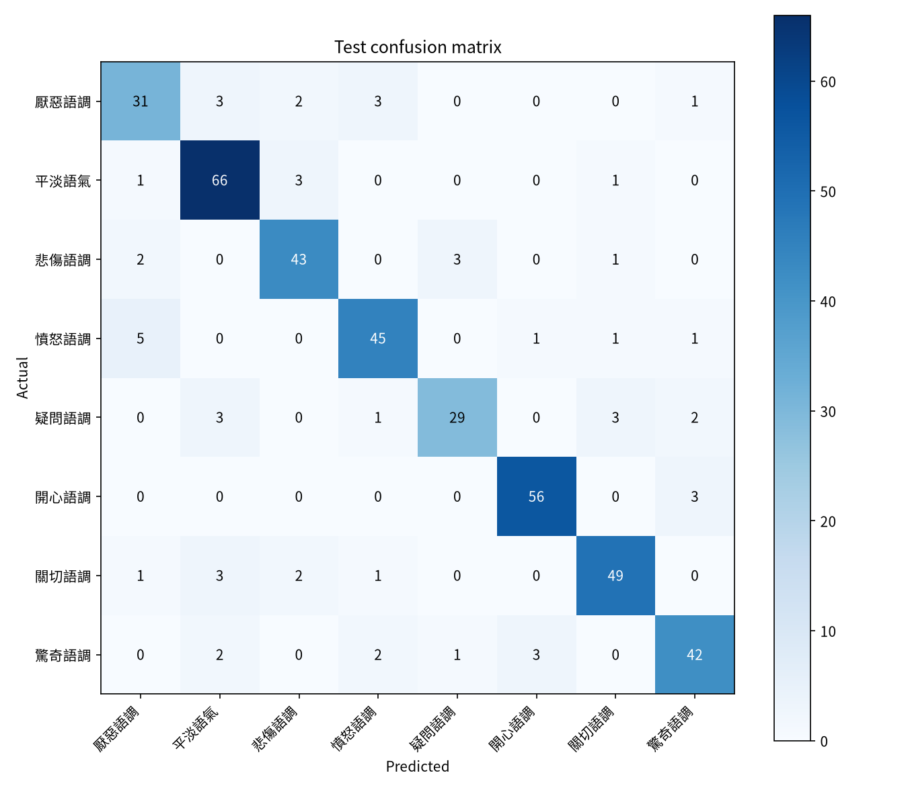

# 作業一：BERT 多元情緒分類

本專案改寫自課程範例 [`cases/bert_finetune`](https://github.com/telunyang/python_nlp/tree/master/cases/bert_finetune)，使用 [Johnson8187 的中文多元情緒資料集](https://huggingface.co/datasets/Johnson8187/Chinese_Multi-Emotion_Dialogue_Dataset) 和 [google-bert/bert-base-chinese](https://huggingface.co/google-bert/bert-base-chinese)，訓練 8 類中文情緒分類器。

資料標籤從下載的 CSV 建立，不採用資料卡上的手寫類別名稱。現有 CSV 的 8 類為：厭惡語調、平淡語氣、悲傷語調、憤怒語調、疑問語調、開心語調、關切語調、驚奇語調。原始 4,159 筆，清理後 4,154 筆；train / valid / test 為 3,323 / 415 / 416 筆。切分種子為 42，切分檔預設不覆寫。

## 環境

建議 Windows 10/11、Python 3.12、NVIDIA 驅動支援 CUDA 12.8；本機為 GTX 1660 Ti 6 GB。PowerShell：

```powershell
cd hw1_bert_emotion
python -m venv .venv
.\.venv\Scripts\python.exe -m pip install --upgrade pip
.\.venv\Scripts\python.exe -m pip install torch --index-url https://download.pytorch.org/whl/cu128
.\.venv\Scripts\python.exe -m pip install -r requirements.txt
```

Linux/WSL 把 Python 路徑改成 `.venv/bin/python`，並按 [PyTorch 安裝頁](https://pytorch.org/get-started/locally/) 選擇適用的 CUDA wheel。`requirements.txt` 列出主要訓練套件；PyTorch 由 CUDA index 單獨安裝。此機實際安裝版本記於 `requirements-lock.txt`，其中 CUDA 版 PyTorch 仍需使用上述 index 安裝。

## 執行

以下命令在 `hw1_bert_emotion` 資料夾內執行；若已手動取得 `data.csv`，用 `.\.venv\Scripts\python.exe download_data.py --source path\to\data.csv`。

```powershell
.\.venv\Scripts\python.exe check_gpu.py
.\.venv\Scripts\python.exe download_data.py
.\.venv\Scripts\python.exe prepare_data.py
.\.venv\Scripts\python.exe train_bert.py
.\.venv\Scripts\python.exe plot_bert_metrics.py
.\.venv\Scripts\python.exe infer_bert.py
```

`check_gpu.py` 確認 CUDA、顯卡與 FP16 矩陣運算。`download_data.py` 保留原始 CSV。`prepare_data.py` 清理空白、刪除重複句與標籤衝突句，使用分層 80/10/10 切分，產生 `data/bert/{train,valid,test}.jsonl` 和 `data/label_map.json`。既有切分不會被意外覆寫；如需刻意重新切分，使用 `--force`。

訓練設定：最大長度 128、train batch 16、累積 2 次、eval batch 32、學習率 2e-5、最多 5 epochs、每 50 optimizer steps 驗證與儲存、早停耐心 3 次。以驗證集 macro-F1 選 best model；測試集只在訓練結束後評估一次。預設在有 CUDA 時使用 FP16；GTX 1660 Ti 若出現 NaN，請把 `train_bert.py` 的 `USE_FP16` 改為 `False` 再訓練。OOM 時可把 `TRAIN_BATCH_SIZE` 減半並增加 `GRADIENT_ACCUMULATION_STEPS`。

## 測試結果

已在 GTX 1660 Ti 完整訓練 5 epochs。以驗證集 macro-F1 選出的最佳模型位於第 500 optimizer step（驗證 macro-F1 0.8896）。在獨立的 416 筆測試集上，accuracy 為 **0.8678**、macro-F1 為 **0.8603**。各類別的 precision、recall、F1 與支持筆數見 `output/bert_emotion_clf/classification_report.json`；其中開心語調 F1 為 0.9412，厭惡語調為 0.7750。這些是此份資料切分和 seed 42 的單次訓練結果。

五句指定文字的實際預測：

```text
我每天都能跟她一起上學，我好開心！ => 開心語調 (0.9887)
最好的朋友要離開臺灣了，以後可能不容易再見面... => 悲傷語調 (0.9874)
我覺得我快不行了... => 悲傷語調 (0.9771)
剛剛收到研究所錄取的通知書！ => 開心語調 (0.9880)
今年的冬天好像比較晚來。 => 平淡語氣 (0.9846)
```

分數為模型 softmax 對預測類別的分數，不能當成已校準的真實機率。







## 輸出檔案

- 模型、tokenizer、`trainer_state.json`、`classification_report.json`、`confusion_matrix.json`：`output/bert_emotion_clf/`
- 訓練與驗證 loss、macro-F1、測試集混淆矩陣：`images/`
- 五句指定文字預測：`python infer_bert.py`，格式為 `句子 => 中文標籤 (0.0000)`。

資料與虛擬環境被 `.gitignore` 排除，過程 checkpoint 會在訓練成功後刪除。`model.safetensors` 約 390 MB，`.gitattributes` 已設定 Git LFS 追蹤；提交前應先在目標 Git 倉庫執行 `git lfs install`。詳細實作過程見 [docs/作業一.md](docs/作業一.md)。
